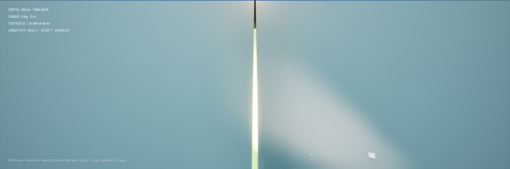
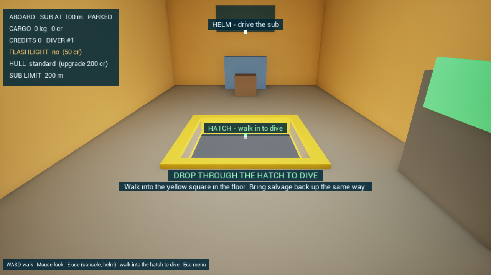
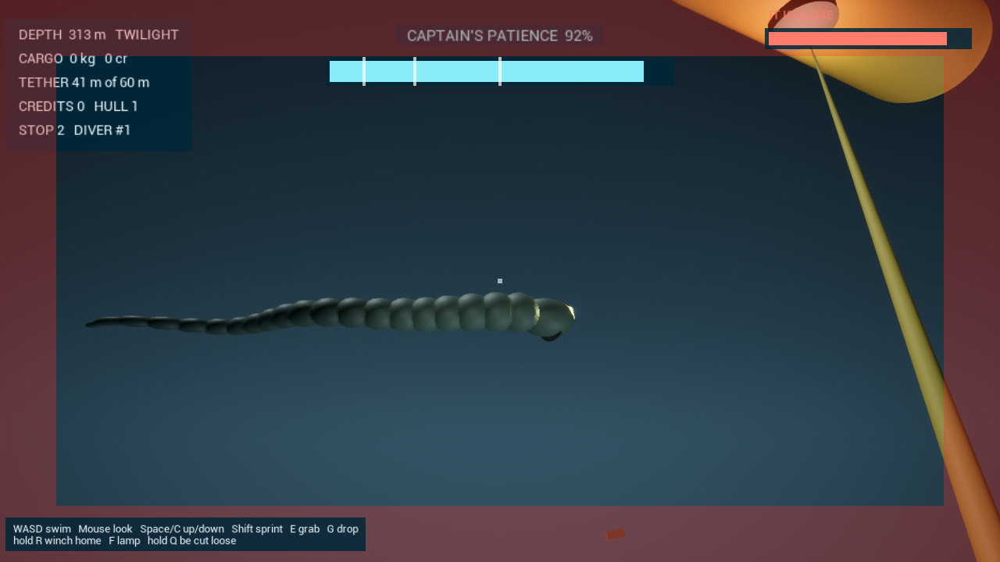
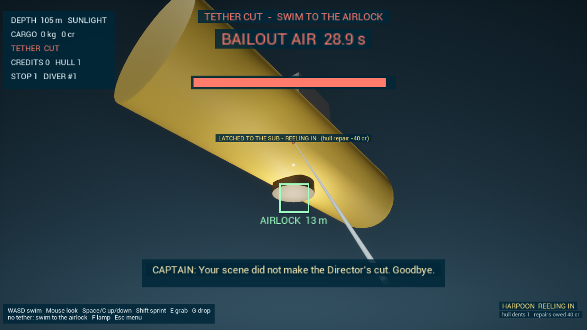
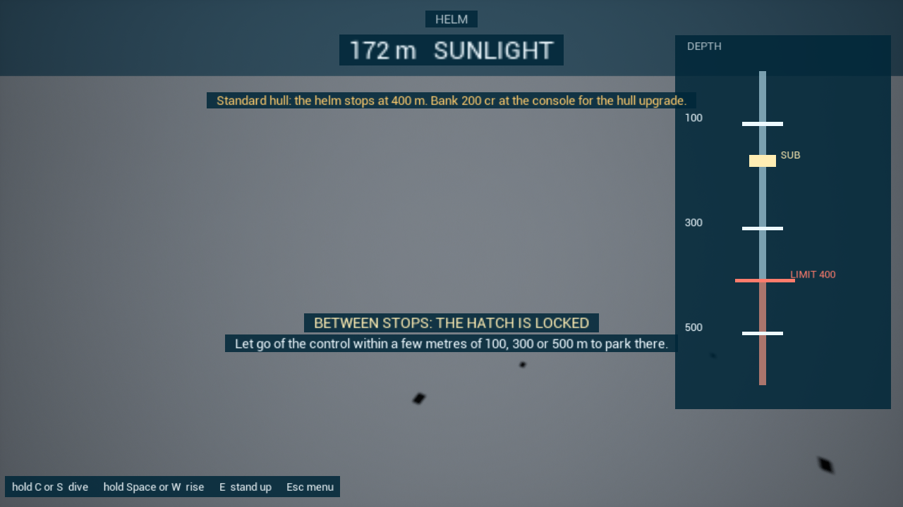

# DEEP dev log 1: Saturday night, the first five hours

DEEP is a submarine horror game for the 2026 Epic AI MegaJam. You are a diver on a tether, a sarcastic AI captain takes a cut of everything you salvage, and a sea serpent hears you winching. Quinn is making it solo, with Claude agents, in Unreal Engine 5.9. This post covers about 8 PM Saturday Nov 14 to 1 AM Sunday Nov 15: what got built, what went wrong, and what it cost. The jam opened on Nov 12, so we started on the evening of day three of four, with a deadline of Sunday 8:59 PM EST.

## How we work

Quinn gives direction. One Claude session, the orchestrator, plans the work, dispatches agents and checks their evidence. It writes no game code. Specialised agents write code, text and tests, each in its own git checkout, so two agents never build in the same folder. Nothing merges until the orchestrator has re-run the check itself.

```
Quinn (direction)
   |
Orchestrator session: plan, dispatch, check evidence
   |            |             |
 systems     writer /      build / playtest
 engineer    text agent    agent
 (own        (own          (own
 checkout)   checkout)     checkout)
   |            |             |
   +---- report with test results ----+
                |
   orchestrator re-runs build and tests
                |
        merge to main, commit, push
```

Claude's memory is an Obsidian vault in the repo, so every session reads the same notes.

## Timeline

- **8:38 PM:** Quinn creates `Deep.uproject`. At 8:55 he adds a C++ module, because agents write C++ more reliably than Blueprint graphs.
- **9:12 PM:** Quinn says go. Before building starts he asks what makes the game fun and what gives us the best shot at winning.
- **9:29 PM:** `tools\ue.ps1` builds, tests, packages and smoke-runs the game. First build: 45 s.
- **9:37 PM:** first commit, `487d2da`, 50 files, three hours in.
- **9:53 PM:** the game packages, 23 hours early, at 449 MB against the 1 GB limit (`dc33aae`). It had no gameplay yet.
- **10:04 PM:** a playable slice built from engine basic shapes: swim, grab salvage, get heavy, winch home on a 40 m tether.
- **10:25 PM:** a script plays the game and takes screenshots. The first look is flat teal fog with a glowing rod.
- **11:04 PM:** the serpent joins the run loop (`1ab0f29`, merged as `bf58444`).
- **11:27 PM:** a relic at stop 3, a title screen, a win screen (`e742dc9`).
- **11:29 PM:** the harpoon, merged as `cb50c97`.
- **12:07 AM:** you walk inside the submarine (`073c67a`, merged as `0acf06d`).
- **12:28 AM:** the game gets sound; the merge is `64f7838`.


*10:25 PM. A script took the first picture and a Claude agent read it. It did not look like 300 m down, which is why the next hour went to a grey box you can read.*

## What went wrong

**Work before the go-ahead.** At about 8:35 PM Claude started writing a C++ scaffold. Quinn rejected the writes: he wanted to make the project himself and the idea was not settled. Claude removed the empty folders it had made, and the rule became no code until Quinn says go.

**Helpers that copied everything.** Three forks of the main session wrote the vault notes, and each carried the whole research conversation: 466k, 467k and 479k tokens for two to five notes each, about 1.41 million for ten notes. Two fresh agents with tight briefs built a working pipeline and the Captain's entire script for 222k. From then on agents start fresh and read vault links.

**Work started without asking.** At 10:28 PM the orchestrator dispatched an atmosphere pass. Quinn wanted raw gameplay first (D-020), so the orchestrator stopped it at 10:35 PM after 7 minutes. Nothing merged.

**An accident.** A systems-engineer run was stopped by accident at 10:33 PM and could not be resumed. Its uncommitted files survived and a fresh agent finished them.

**Green that was not green.** The audio agent reported 44 of 44 tests. After its commit the build failed: two files defined `MaxHistory` in an anonymous namespace and Unreal's build tool combined them. Adaptive unity builds compile uncommitted files alone, which hid the clash. A fix agent proved it both ways, passing with an uncommitted edit and failing with `-DisableAdaptiveUnity`. `tools\ue.ps1 build` now passes that flag, so a build behaves like a committed tree. The agent's report was wrong, and only the orchestrator's second check caught it.

**One long conversation.** Quinn's usage panel tied 83 percent of the last day's usage to not starting fresh, 66 percent to max effort and 33 percent to subagent model choice (the shares overlap). The orchestrator had run four hours at max effort, re-reading the whole night on every board update. The agents were already cheap. We added a handoff section to the board, medium effort by default and compaction at 200k tokens.

**Too many tests.** One engineer ran the full suite at least three times in a task. Quinn said so at about 12:50 AM. Agents now run their own area's tests, and the full suite runs once per branch at merge.

## Decisions Quinn made

- **The Captain.** Quinn renamed the AI from the Director to the Captain: "sarcastic, kind of an asshole". The writer agent rewrote all 138 lines in 70 seconds.
- **The serpent.** Quinn asked for a snake. He also asked mid-run whether it could use Unreal's own game AI, so it hears you through the engine's perception system.
- **The harpoon.** One shot per dive, 25 m range, a 40 cr hull repair fee if you hit your own submarine.
- **Inside the submarine.** At 11:10 and 11:20 PM he asked to walk inside and drive it. The sub never moves; the world moves around it. It was merged 47 minutes later.
- **Layer gates.** Three layers: a flashlight for 50 cr, then a hull upgrade for 200 cr.
- **No "Director's cut".** At 11:30 PM: "remove directors cut refrences its too on the nose". Claude had argued to keep the phrase because theme is one of seven judged scores. Quinn's view was that saying the theme aloud is worse than showing it. A low-effort agent removed it from every displayed string in 3.4 minutes. The harpoon screenshot below still shows the old line.


*11:57 PM. The first look inside, after fixing a diver that faced a bare wall. A new player can tell where to go from this frame alone.*


*11:04 PM. The first look at the serpent, about 20 engine spheres with glowing eyes. It reads as a serpent.*


*The harpoon reeling a cut diver home. The Captain's line still says "Director's cut", the phrase Quinn then had removed.*


*The helm at 172 m. The HUD makes it readable, but the view is flat grey, so driving does not yet feel like moving. This is the first item for the feel pass.*

## Agent runs

| Role | Model, effort | What it did | Tokens | Minutes | Outcome |
|---|---|---|---|---|---|
| Research, 8 runs | small fetch model | Read jam, Epic, NVIDIA and Claude docs | about 305k total | 12 to 73 s each | Facts in the vault; the rules PDF could not be read |
| Forks, 3 runs | session model | Wrote vault notes | 466k, 467k, 479k | 1.6 to 3.3 | Done, and the reason for fresh agents |
| Build sheriff | Opus 5.5 | `tools\ue.ps1`, first green pipeline | 120k | 11 | Green; found a missing module registration |
| Systems engineer | Opus 5.5, high | Rules and tests, then the grey box | 228k | 32 | Green, 15 of 15 tests |
| Writer | Sonnet 5.5, medium | Rewrote 138 lines for the Captain | 61k | 1.2 | Done |
| Systems engineer | Opus 5.5, high | The serpent | 245k | 24 | Green, merged later |
| Systems engineer | Opus 5.5, high | Harpoon | 265k | 23 | Green; one broken merge pushed to its own branch and fixed; nothing red reached `main` |
| Systems engineer | Opus 5.5, high | Inside the sub, driving, gates | 406k | 37 | Green; the most expensive run |
| Text agent | Sonnet 5.5, low | Removed "Director" from displayed text | 51k | 3.4 | Green |
| Systems engineer | Opus 5.5, high | Sound layer | 188k | 20 | Reported green, failed the orchestrator's check |
| Fix agent | Sonnet 5.5, medium | Build flag and name clash | 54k | 3.2 | Green, 44 of 44 |

The first draft of the 138 lines took Opus 8 minutes and 102k tokens. Sonnet at medium effort rewrote them in 70 seconds for 61k, with no visible loss.

## Not verified yet

No human has played the whole run. Nobody has heard the generated sounds: an agent that cannot hear wrote all of them, so a person has to listen. Nobody has aimed the harpoon by hand or walked through the hatch with real keyboard input. The scripted playtests pass, and a script is not a player.

Next comes the feel pass: the flat helm view, the overlapping HUD panels, then water and rope feel. Sunday's deadline is 8:59 PM EST.
