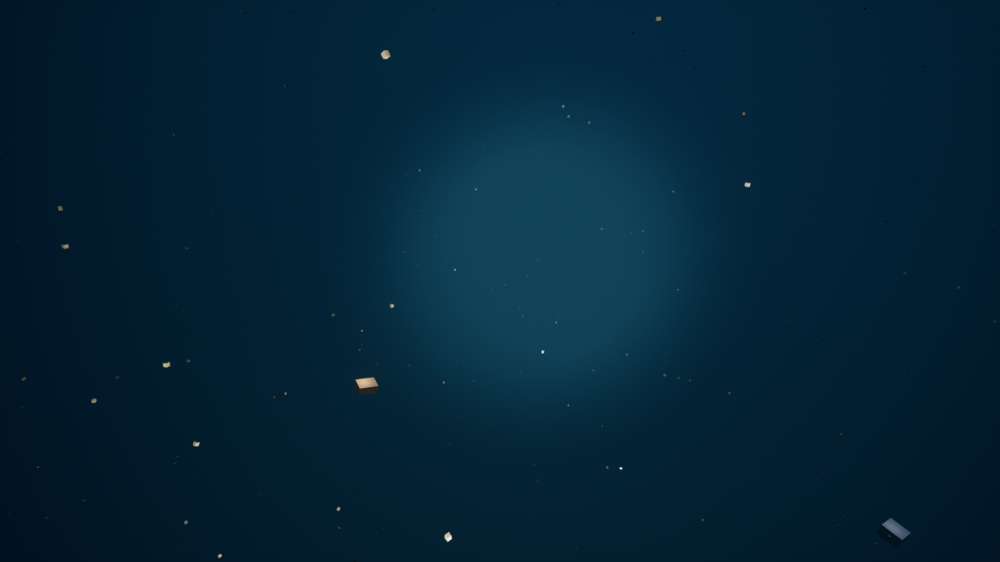
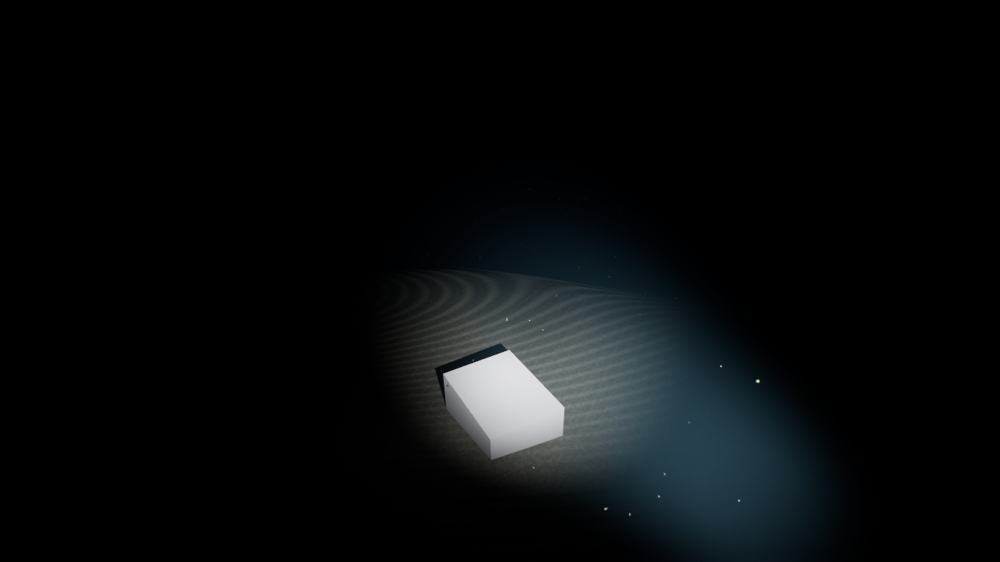
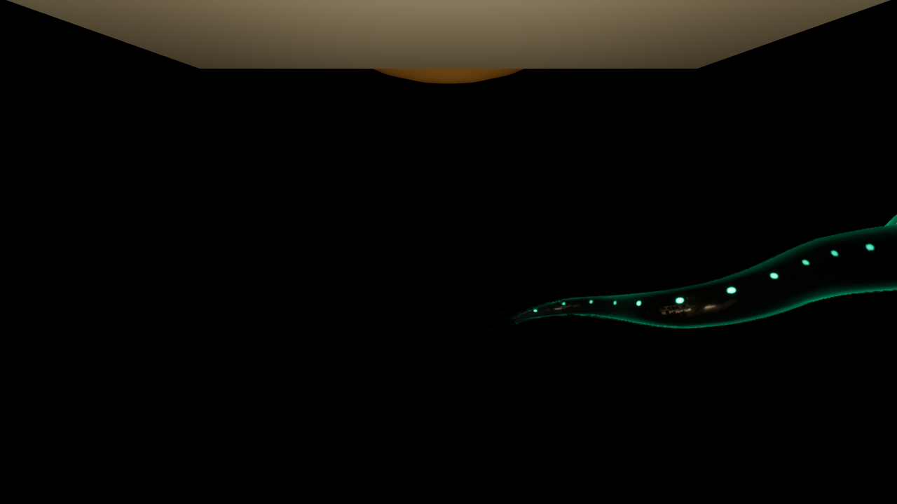
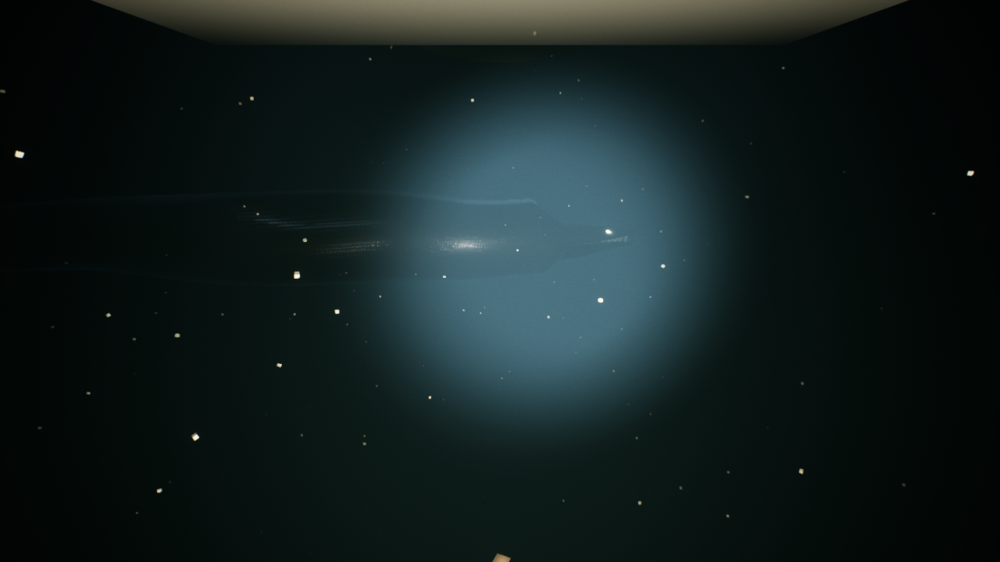
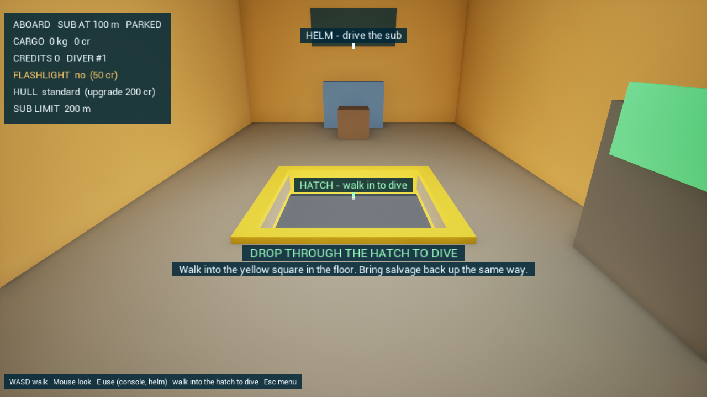
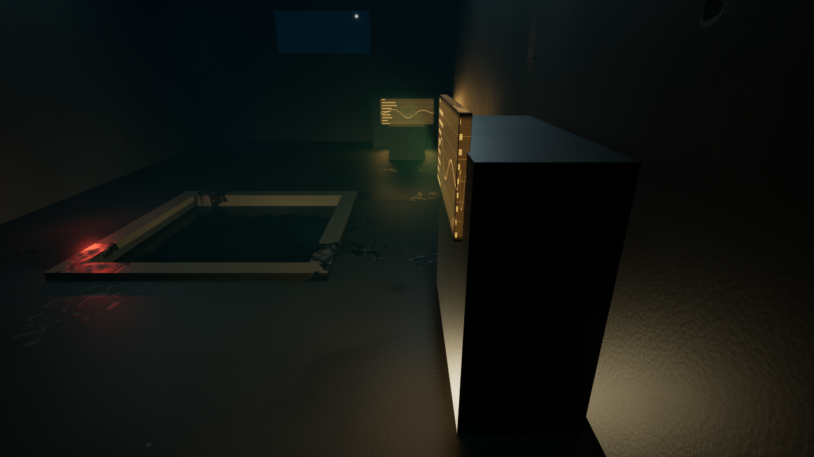
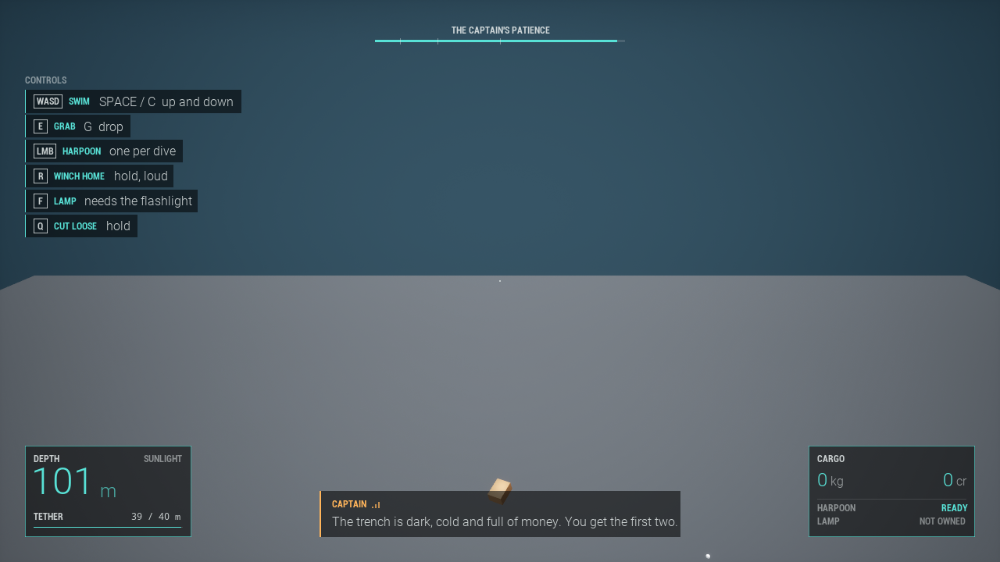
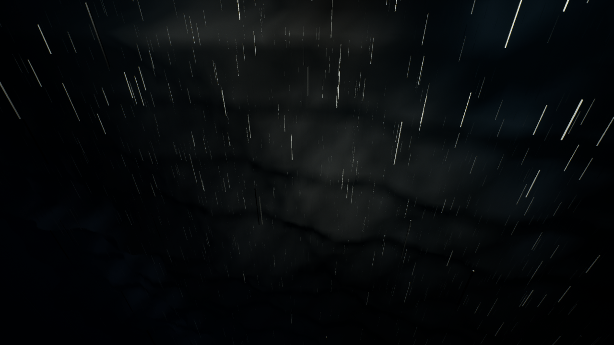

# DEEP dev log 2: Sunday before dawn, the polish pass

The first post ended at about 1 AM Sunday Nov 15 with a game that played from the title to the win as grey boxes: a diver on a tether, a Captain who takes a cut, a serpent, a submarine you can walk around in and drive. This post covers about 1 AM to 5:20 AM. In those four hours Quinn changed what the team was building toward, seven times, and the agents spent the time on research, on the first real look for the sea, the serpent, the room, the HUD and the driving view, and on the orchestrator's own mistakes. The deadline is Sunday 8:59 PM EST.

## The human's calls that turned the night

Each of these is a message from Quinn. The quotes are his, typos included. The notes log what changed within minutes of each.

- **Too many tests, about 12:50 AM.** "we are running too many tests on changes that dont need them be adaptive we can run all tests on merge." The rule became: an agent runs its own area's tests, and the full suite runs once, at merge. The next engineer, started at 1:01 AM, was the first to work under it.
- **No half-done polish, about 1:10 AM.** "i guess in want to wait on the polish and not half do it, or get it good enough think AAA prtofesional sleek ect". An engineer was halfway through a batch that patched the placeholder HUD and added grey-box motion cues for driving. Two of its four items were cut mid-run and the code was parked on a branch. The title key press and a state bug stayed, because they are function.
- **Looks are as important as gameplay, about 1:25 AM.** "looks is just as imporatnt than gameplay polish is a VERY big deal research if you need ect". Three research agents started at 1:32 AM. Nothing visual was built yet: the point was to prepare the whole pass first.
- **One style for everything, about 1:45 AM.** "a game will wlayes look bad if theres a strong discrepancy in style". The rule: assets, HUD, effects, type and sound follow one written style, and a good asset that clashes is left out. By 2:42 AM a writer agent was producing the style guide.
- **Playtests can wait, about 2:30 AM.** "we are taking to long to run the play test i feel ask if w e can ignore and do laTer". The agent that was speeding up the scripted playtests was stopped on the spot and its work parked. Playtests now run at checkpoints.
- **Realism, led by light and reflection, about 2:40 AM.** "im leaning twoard realism wtih all the quixel assets, we really jsut need good water effects and a good monster", then "this is horror after all maybe we could do some nice path tracing some reflective things off teh water falashlight". The style guide was told at 2:44 AM to be light-led, with ray-traced reflections. Unreal's path tracer is offline only, so the project uses Lumen with hardware ray tracing.
- **Go, then the dragon, 2:47 and 2:56 AM.** He approved the polish pass seven hours before the plan said to start it, and allowed agents to create materials and particle systems in their own folders, provided they look up how an effect is done first: "since the feedback loop is slow rather tahn infer i would like you to look onliune for things or tutrials then do it". At 2:51 AM the water lane and the serpent lane started. Then, on seeing a pack picture: "yes that dragon is perfect I think we should def use that or some varient of that for sure". At about 3:00 AM he added: "im worried about this not looking cood". The serpent now has a head socket that takes a mesh, but only Quinn's account can install the pack, so the dragon head is not in the game.

## Research before building

Six agents ran between 1:32 and 2:07 AM, five on Sonnet at medium effort and one on Opus at high. An asset scout read Quinn's Fab library and the free listings: 61 picks in seven groups, 25 owned and 36 free. It could not see thumbnails, so its style notes came from text and needed a human eye. Quinn's 208 non-Megascans packs held no realistic sea creature. A web researcher covered sound, music, the Captain's voice and fonts with licences, and could not confirm the jam's rules on third-party assets because the Official Rules PDF is unreadable to our tools. Two more looked for other Unreal MCP servers and for a polish checklist. A technical art lead wrote the plan: ten work packages in three lanes.

The most useful result came from the agent that read Epic's own material. About 41 skills ship inside Unreal 5.9's toolset plugins, for Niagara, MetaSound, Sequencer, widgets and scene capture. They are written for AI agents. That agent found five corrections to our plan, the best being that marine snow can start from a stock Niagara template. The project rule now reads: read Epic's built-in skill first, then documentation or a tutorial, write the recipe down, build once. For the pack pictures, the orchestrator looked at them itself and found that one pack, the Sci-Fi Creatures Research Lab, is clean, bright and teal and does not read as a worn submarine.

## The polish pass, lane by lane

Each lane works in its own checkout and branch. The orchestrator looks at the frames and writes a review before a second pass is dispatched.

**Water.** The first pass (47 minutes, 286k tokens, 13 ms a frame at 1080p) got the depth mood right. The engineer found the style guide's fog numbers were about thirty times too thin, because the engine divides fog density by 1,000. The review looked at the frames and rejected the rest: the lamp was a soft disc that landed on nothing, the 3,000 specks read as a starfield, every frame looked into empty water, 500 m was green and not black, and there were no light shafts. The second pass (40 minutes, 274k tokens) built a silt sea floor in code, moved the lamp to where a hand holds a torch, shrank the 9,000 specks to 2 to 4.5 mm, faded the sub's own lights by depth so 500 m is black, and added shafts at 100 m. The review called the frame of the beam raking the floor onto a crate the first one that looks like a game. It still burned the floor white at 3 m, and the crate is a plain white box.

*First water pass, rejected: the lamp is a disc of lit fog that lands on nothing, with specks like a starfield.*

*Second pass: a cone from low right, rippled silt, a hard shadow. The crate is still a grey-box placeholder.*

**Serpent.** The first pass (46 minutes, 303k tokens) replaced twenty spheres with one tapering body. The engineer's own verdict: "it still reads as a glowing eel, not a horror animal". The orchestrator agreed: a teal rim glow outlined the whole body. The second pass turned the rim off, made the skin near-black with round overlapping scales under a wet clear coat, made the animal 16 m long, and gave it a flat head with two rows of teeth and small eyes that shine only in the lamp. The engineer called the side view the best frame: something big, seen by what it blocks. The orchestrator's review picked the recoil frame, a huge scaled body crossing the beam, and the lit eye with its row of teeth. A third pass staged the first sight: a sound, then the head crossing the beam at 7 m. Its verdicts were mixed. The pass reads as a long-snouted fish with no scale, the body crossing the beam is the good part, and the bite is "frightening as a silhouette, not readable as a bite".

*First pass: the glowing teal eel. The rim light draws the whole outline, which is why it read as friendly.*

*Second pass: a dark scaled body that shows only where the lamp catches it. It is faint, and it is the better animal.*

**Room.** The review named five faults: flat orange and grey boxes under flat light, the lamp burning the floor white, a black driving view, a grey slab for a hull from below, and glaring white crates. One pass added a worn-steel material built from 3D noise, two cool ceiling strips, amber screens that light their own corners, red emergency light at the hatch, and a locked interior exposure so the sea's brightness does not leak in. The lamp now dims as the beam meets a surface closer than 7 m. The engineer's verdict on the first view: "It reads as a place now." The window, it said, would not pass, and the walls are still big flat boxes.

*Before, from the first post: orange walls and a yellow hatch. It was readable, and flat.*

*After: dark worn steel, an amber console screen, a red light raking the hatch rim, a black pool. Not commercial yet.*

**HUD.** The old HUD drew every number at once in boxes. One Slate widget in C++ replaced it, with one set of panels per mode, so nothing from the water shows aboard, and every colour and time taken from the style guide. Its first run lost half of every key-cap outline: a one-unit line is 0.67 of a pixel at 720p. The frames were shot on a bright grey world, so they only prove legibility. The dark scene is untested, and the threat edge and bite band were built but not yet seen in a frame.

*The HUD in the water: depth and tether bottom left, cargo bottom right, patience across the top, the Captain in one place.*

**Driving.** The helm view was near black: a pair of frames one second apart differed in 357 of 14,400 sampled pixels. A pass of floodlights, speed streaks and a trench wall with a ledge every 10 m raised that to 2,691. The engineer's own list of what is wrong: the streaks are uniform white lines that lean toward rain, and the floor rising into the lights is weak.

*Mid-descent. It reads as moving now. It also looks like rain.*

## The orchestrator's failures

**Visual work, unasked, a second time.** The first was the atmosphere pass at 10:28 PM. The second was the HUD and motion batch that Quinn stopped at 1:10 AM. Patching a HUD that will be replaced is work thrown away. Both times the orchestrator reached for visuals before the gameplay was settled.

**A red merge, pushed for about ninety seconds.** At 4:53 AM the orchestrator merged the HUD into the integration branch and pushed. It did not build: the serpent and the HUD each had a helper called `EaseOutCubic`, and the combined build could not choose. The orchestrator's check read an exit code, and a new lock wrapper around the build script had swallowed the real one, so the check saw success. The fix went in at 4:55 AM, with the serpent's helper renamed. The check now also reads the PASS line, and the dev log says what happened.

**What worked.** The scripted playthrough on simulated keys found a real bug: swimming straight at the hatch from the side stalled 5 m out against the hull until the Captain cut the line and the diver died. The hatch is 0.2 m above the hull's underside and the diver is 1.6 m tall. Run 45 fixed it, and its tests checked that the diver gets home from seven points. And one frame comparison caught a gap: a smoke run looks at nothing, so a checker captured frames from the packaged build. Its first two frames showed only the title screen, because the start command did not take effect in the package. After waiting before it, all three frames matched the editor.

## How the work is organised now

- One lane per engineer, each in its own checkout and branch, with its own scratch file names. In the first water pass, two lanes shared one scratch folder and one overwrote the other's draft.
- A written review of the frames before every second pass.
- An integration branch for water, room, monster and HUD. At 4:22 AM it passed 54 of 54 tests, at 5:20 AM 60 of 60. Nothing goes from it to `main` until Quinn has seen frames.
- A machine-wide lock around Unreal, because the machine has 32 GB of RAM and Quinn's own editor is open, so agents must not start Unreal at once.
- A packaged build, 427 MB zipped, smoke clean, compared with the editor by eye.

## Agent runs, 1 AM to 5:20 AM

| Role | Model, effort | What it did | Tokens | Minutes | Outcome |
|---|---|---|---|---|---|
| Engineer, fix batch one | Opus 5.5, high | Title key press and a state bug | 220k | 24 | Merged; cut to two of four items |
| Research, 5 runs | Sonnet 5.5, medium | Fab library, Epic's built-in skills, sound, voice, fonts, MCP servers, polish checklist | 68k to 168k each | 1.6 to 6.9 each | All merged |
| Technical art lead | Opus 5.5, high | The polish plan | 133k | 7.5 | Merged; ten packages in three lanes |
| Playtest agent | Sonnet 5.5, medium | Stop 1 on simulated keys | 177k | 30 | Found the hatch stall; overran its budget |
| Engineer, fix batch two | Opus 5.5, high | The hatch stall and the walk layout | 191k | 15 | Merged, 52 of 52 tests |
| Playtest agent | Sonnet 5.5, medium | Faster playtests | 108k | 20 | Stopped at 2:30 AM, parked |
| Writer | Sonnet 5.5, medium | The style guide | 84k | 2 | Merged; 131 lines, over its 100-line limit |
| Lighting and water engineer, 2 passes | Opus 5.5, high | The sea | 286k, 274k | 47, 40 | First pass not at the bar; second a real base |
| Creature engineer, 2 passes | Opus 5.5, high | The serpent | 303k, 269k | 46, 37 | First not good enough; second a step forward |
| Lighting engineer | Opus 5.5, high | The room, the hull, salvage and the lamp at close range | 261k | 36 | Merged into the integration branch; by its own count two of six items done, three improved, driving not solved |
| Creature engineer, third pass | Opus 5.5, high | The staged first sight, the bite from the side | 238k | 27 | Merged into the integration branch; the staging is right, the head is weak |
| Interface engineer | Opus 5.5, high | The HUD | 262k | 33 | Merged into the integration branch; the lane that came out best |
| Lighting engineer | Opus 5.5, high | The view while driving | 227k | 17 | Merged into the integration branch; reads as motion, the arrival does not land |
| Checker | Sonnet 5.5, low | Three frames from the packaged game, compared with the editor's | 66k | 4 | All three match after a wait before the start command |

A test of NVIDIA's DLSS plugin never started. The session's permission system refused it at 2:42 AM, because it would have downloaded a plugin into the project.

## Not verified yet

No human has played this build or listened to it. The dragon head is not installed, so the serpent's head is still a code-built wedge that reads as a cone up close. The real environment art, the Megascans rock and the salvage models, is not in: the crates are still boxes and the room's walls are flat. The NVIDIA plugin test waits on Quinn. The HUD has not been seen on the dark scene, and its threat and bite cues have not appeared in a frame. Driving still looks like rain.

Next: Quinn looks at the frames. A settings and credits screen, a scripted playtest as the check before the merge to `main`, and the room, serpent and HUD second passes follow. Sunday's deadline is 8:59 PM EST.
