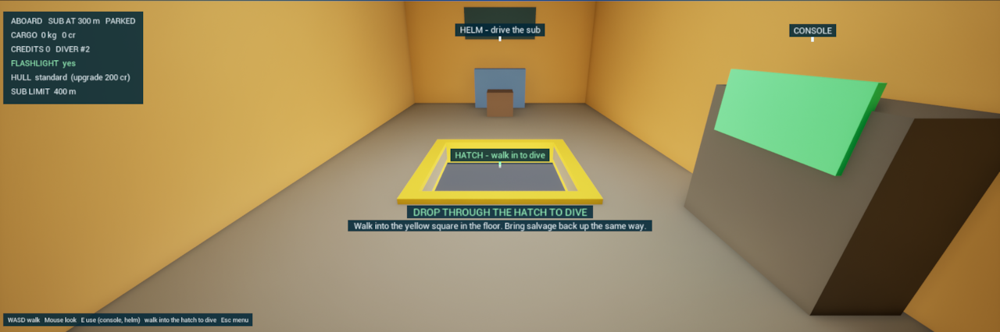
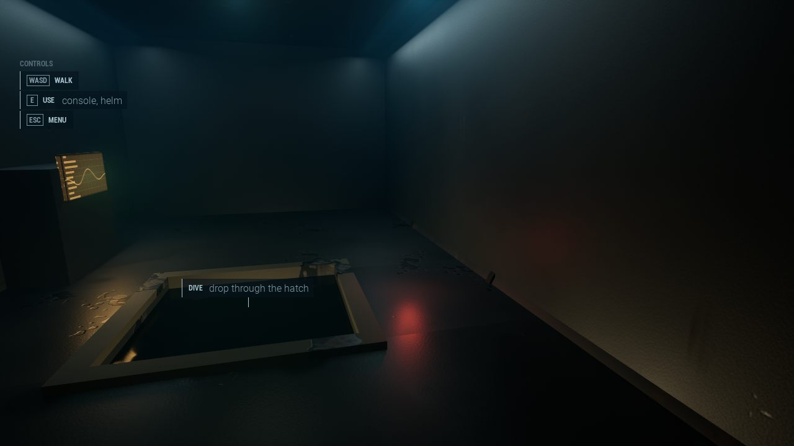
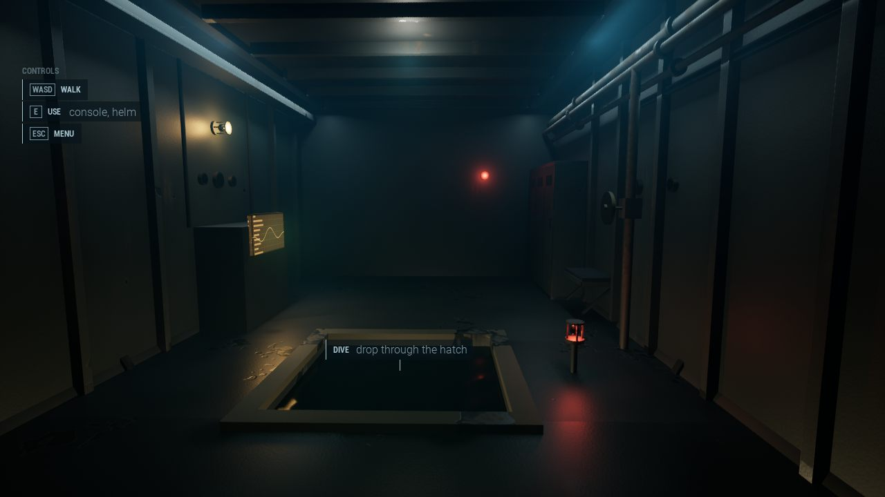
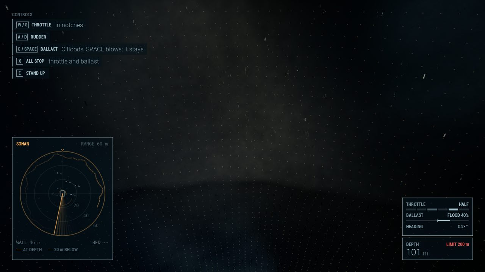
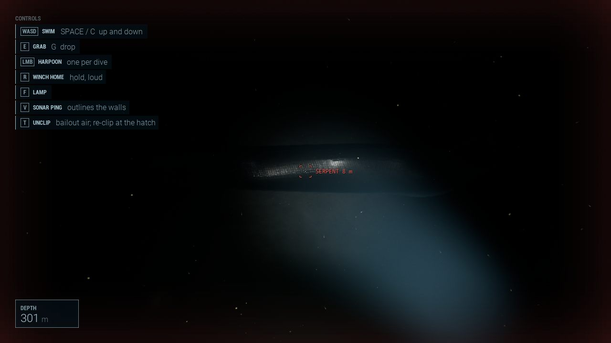
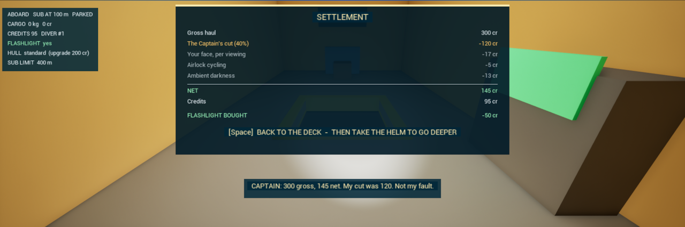
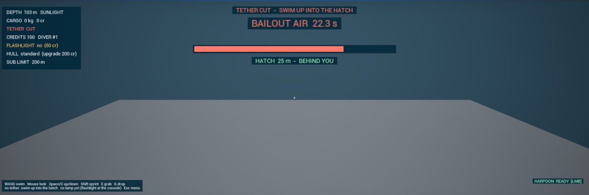
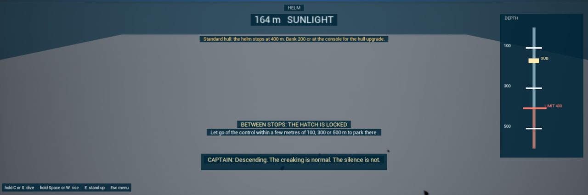
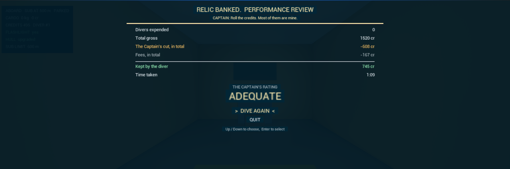

# DEEP dev log 2: Sunday, from the night shift to the freeze

DEEP is a submarine horror game for the 2026 Epic AI MegaJam. You pilot a cheap submarine down a generated cave and dive from it on a tether that is also your air line. A Captain who never says a word takes 40 percent of everything you salvage, and a sea serpent hears you working. Quinn is making it solo, with Claude agents, in Unreal Engine 5.9. This post covers Sunday Nov 15, from about 1 AM to 6:20 PM EST, when the freeze run-through passed. The deadline is 8:59 PM.

## Where Saturday ended

By 1 AM the game was a playable loop built from engine basic shapes, with a serpent, a harpoon, a submarine you walk around in and drive, and a sound layer. No human had played a whole run. Post 1 has the details.

## Timeline

Times are EST. SHAs are short commit hashes as the raw log records them.

### The night shift, 12:36 AM to 7 AM

- **12:58 AM:** the scripted playtests are rewritten for the submarine. Eight of the nine old scenarios failed on the new game, so they became eight that assert on game state. Two full passes, 8 of 8.
- **About 1:10 AM:** Quinn stops a batch that was patching the placeholder HUD. The rule becomes: fix function, not finish, and do the finish later in one planned pass, "AAA professional sleek" (D-028).
- **1:24 AM:** the title screen now leaves on a key from the real input path. Quinn cuts the helm motion cues halfway through the task. The code is parked on `parked/motion-hud`, not merged.
- **1:32 AM:** Quinn says looks weigh as much as gameplay and polish is "a VERY big deal". Three research agents start: his Fab library, sound and look techniques on the web, and a plan for the work.
- **4:55 AM:** the orchestrator pushes a red merge to the integration branch for about ninety seconds (details below).
- **7:00 AM:** the orchestrator finds `deep/Content/DragonCave/` on the disk: 4.8 GB, 333 files, written at 3:31 AM. Quinn had installed the pack and gone quiet, and for three and a half hours the board said "waiting on Quinn to install Dragon Cave". The pack stays out of git by an ignore line (`ab814a6`), and two lanes start on it: the dragon's head for the serpent, and rock and ruin for the dive sites.

*2:09 AM. The first playtest on simulated keys, in the greybox room.*

### The polish pass, 7 AM to 11 AM

The rule for the pass was to prepare it whole and build it once, with assets and techniques chosen first (D-029). Quinn set three more rules in the night. At about 1:45 AM: "a game will always look bad if there's a strong discrepancy in style". So everything the player sees and hears follows one written style guide, and a good asset that clashes is left out (D-030). The guide was drafted from the research by 2:40 AM, and Quinn confirms it by approving frames on a private page; nothing visual reaches `main` before that. At about 2:47 AM Quinn let agents make materials and particle systems in the editor, each only in its own lane folder (D-033). In the same message: look it up first. Before building an effect, an agent reads the engine's own skill for it and the documentation, writes the recipe down, and builds it once, because the editor loop is too slow to guess.

- **8:40 AM:** the first package with the pack in it is 1,318 MB, over the 1 GB limit. The 37 textures behind 42 placed meshes are 1.9 GB of source. The package also showed a missing Nanite flag, so the cooked rock fell back to grey, and that the merged game did not compile, because the merge gate built only the editor. The texture limit took three tries, each measured with a real package. The third gave 679 MB (`b3a184c`).
- **9:00 AM:** the dragon's head merges at `6746147` and the relic's well at `5ae5f0b`. The zip is 762 MB. The black pillars were never a light problem: the surface had picked up the wrong textures.
- **10:40 AM:** the lamp lane finds five causes for one white disc. The fifth was that the relic's pit was a funnel, so the lamp lit a wall half a metre away. Afterwards all 14 playthroughs pass, including `S10-cutdrop`, which had never passed before. Integration is at `a942e1c`.

*1:24 AM. The title after the key fix, in the early greybox UI. Pressing a key on the title is the first thing a judge does.*

### The crash, 11:19 AM

- **11:19:45 AM:** the PC reset without shutting down (Kernel-Power 41, no bugcheck). The orchestrator and all three running engineers went with it. The well merge had just passed its gate (78 of 78 tests), a package, a smoke run and a 762 MB zip. The cause is not proved. Two Unreal editors were open, which breaks the board's own rule for a 32 GB machine.
- **11:31 AM:** a new session pushed the green merge (`b7755a1`) and rebuilt its picture from git, the board and the tail of the old log in about ten minutes. Everything committed survived, which is the argument for committing at every green step. Lost: the engineers' context, the ending playtests on the new build, and a half-built fourth try at bubbles.

### Quinn changes the game, noon to 4 PM

- **12:02 PM:** Quinn rethinks the game: "what makes this game fun and driving the sub with a radar mechanic or something is part of it really also i think we must do caverns because if your swimming in an open ocean it really lessens it". The orchestrator pushed back on free driving through tunnels and offered a version that kept the sub, tether and stops. Three Opus engineers start on a cave shaft, caverns and a sonar. The freeze moves from 3 PM to 5:30 PM (D-038, D-039).
- **12:47 PM:** the Captain and sound lane merges (`6aeafc8`), 26 minutes after it started. The writer cut the Captain's lines from 185 to 74 in 2.4 minutes.
- **1:41 PM:** the cave shaft passes the gate (`59af289`, 107 of 107 tests). Its rock had lost its collision when the caverns merged in. UE 5.9 caches a procedural mesh's cooked collision by its simple geometry alone, so every rock mesh shared one cook.
- **2:23 PM:** the serpent is one model again, with a head built in code and a jaw (`8b5b100`). The pack's dragon head is no longer used.
- **2:25 PM:** `S11-pass` is found to have passed for the wrong reason (see below). Rewritten at 3:00 PM (`7eb79d8`).
- **3:17 PM:** the serpent's body moves by physics, a chain of points the head drags through the water (`964c66e`). Quinn had said the slither was not realistic.
- **3:40 PM:** the harpoon kicks back (`cee150a`), 18 minutes from Quinn's ask to a tested build. 128 of 128 tests.

### The verdict and the re-scope, 3:50 PM to 5:55 PM

At about 3:50 PM Quinn played the build and wrote that the game was not great: the sub could not be moved on every axis, "The UI is still too cluttered and really takes away from the immersion." "The interior is still not great", but the environment was what was really lacking. "The whole tether mechanic seems a little pointless as it stands", the Captain was still useless, and everything felt ad hoc and hacky, without real polish or immersion. He said that at this point he did not think the game was even worth submitting.

The orchestrator disagreed about not submitting. Integration `cee150a` was already packaged and tested, a 762.7 MB zip, so it was a floor the team could always ship. Not submitting scores zero for certain, and the dev log is judged on its own for the Glass Box prize.

Five lanes started at about 4:15 PM, one per complaint, each an Opus engineer on its own branch from `cee150a` (D-048):

- **Helm:** a throttle with notches, a rudder with inertia, a ballast lever, and X for all stop.
- **Cave:** one seeded noise function shapes both the visible mesh and the collision, so what you see is what you hit.
- **HUD:** a pass that only removes.
- **Tether:** the line becomes the air line. A serpent bite through it leaves the diver on bailout air.
- **Interior:** about 100 pieces of dressing.

The merges came fast: the air line at 4:31 PM (`63830a0`), the calm HUD at 4:48 PM (`03b9c72`), the dressed room at 4:51 PM (`5e530da`, 149 pieces in 15 instanced meshes) and the helm at 5:05 PM (`ea92861`). After playing, at about 5:00 PM, Quinn sent a second round: the flashlight cone too small, a better way to control the sub, a serpent that taunts and can be heard. Two more lanes started at about 5:10 PM (D-049), for the light and the serpent. The cave, serpent and light merged between 5:33 and 5:43 PM (`fe11bae`, `852d76c`, `7698723`). At 5:45 PM the merged gate passed with 164 of 164 tests. All seven re-scope lanes were in one build.

*Before: the hatch room in `cee150a`, the build the five lanes started from.*

*After: the same view from the interior lane, which merged at 4:51 PM.*

### The freeze run-through, 6:05 PM to 6:20 PM

Every lane had merged by 5:43 PM, so waiting for 6:45 PM would only have found a failure 40 minutes later. Main's notes merged into integration as `9ac970e` (no code), and the full run-through started at 6:05 PM in one Unreal slot. At 6:20 PM it had passed:

- verify: 164 of 164 tests in 57 s;
- all 14 playthroughs, in 12.5 minutes, including the eight that had not run on the merged build;
- the package (63 s, 1,048 MB), a clean 25 s smoke run, and the zip (31 s, 762.9 MB, under the 1 GB limit).

The build is copied to `Builds\Freeze-1820`, outside git, so a later package cannot overwrite it. That was 2 hours 39 minutes before the deadline.

*From the 6 PM frames page, captured on the lanes' branches before the freeze. The new helm: the throttle sits at HALF, the ballast is 40 percent flooded and stays there, and the sonar draws the cave wall 46 m away.*

*From the same page: the serpent's taunt, its body sliding through the lamp 8 m away, 301 m down.*

## How the work was run

One orchestrator session plans, dispatches and checks evidence, and writes no game code. Each lane works in its own git worktree on its own branch, so two agents never build in the same folder.

**Model tiers.** The rule is the cheapest model that passes the gate first time, never above Opus 5.5. Before this post was written, the run table had 101 runs. 54 are Opus 5.5 at high effort (critical-path gameplay code: the helm, the cave, the tether, the serpent) and 28 are Sonnet 5.5 at medium effort (writing, scripts, the itch page, research). 5 are forks of the main session, the expensive mistake from Saturday. The other 14: 8 web-page fetches on a small model on Saturday evening, and 2 each of Sonnet at low effort, Sonnet at high effort and Opus with no effort set. A resumed agent pays for its history: the second pass on the well cost 691k tokens in 42 minutes, against 492k in 66 for the first.

**The gate before every merge.** Build, automated tests, scripted playthroughs, then a package and a smoke run for any branch that touches C++, materials or pack content. A merge needs a zero exit code and the PASS line. Late in the day Quinn added a rule (D-045): the orchestrator reads each diff itself, then runs verify, then only the playthroughs for the area. The full run-through waits for the freeze.

**One Unreal process at a time.** After the crash, every build, test and frame waits for one machine-wide slot. At 5:10 PM four building lanes, one gate run and two editors shared 31.6 GB with 5.1 GB free, so each lane was told to keep one editor at a time.

*12:58 AM. The settlement screen from a scripted playtest, in the greybox. The Captain's cut is 40 percent: 120 of a 300 cr haul.*

## What failed or was thrown away

- **A red merge, pushed by the checker.** At 4:55 AM the HUD branch and the serpent branch each built alone and not together. Both had a helper called `EaseOutCubic`. The orchestrator had wrapped its check in a machine-wide lock twenty minutes earlier, and the wrapper threw the exit code away: the output said FAIL and the script said 0. It was caught by reading the output and fixed by renaming one helper (`53b045c` red, `c562939` green). It never reached `main`. The gate now needs the exit code and the PASS line.
- **"The game could not be won."** At 5:50 AM the orchestrator told Quinn so. The playtest script was the bug: it winched in bursts, and a player who held the winch won every time. A scripted player is a witness, not a judge.
- **A script that passed for the wrong reason.** `S11` counted any state other than "tethered" as "hunted", so the Captain cutting the line passed it. The earlier passes were probably the same.
- **Agents in each other's way, three times.** Live Coding in one editor blocked every other lane's builds, one engineer's calls reached another's editor on a shared port, and the orchestrator's own open editor failed its next merge half-way.
- **Bubbles, four tries.** A mirror-sphere version was rejected by its own engineer. A Niagara version shipped nothing, because a bubble breathed out at the mask is never inside the lamp's narrow cone. The fourth is committed, unfinished, on its own branch.
- **Still short at 6:00 PM,** per the frames page: the helm's levers are plain sticks, the cave rock barely reads from the helm, and the wider lamp is still dim at 501 m.

*12:58 AM. A cut diver in the scripted playtest, in the pre-re-scope tether: swim home on bailout air.*

*12:58 AM. The old helm: flat grey, with LIMIT 400 on the depth gauge. The re-scope replaced this helm.*

## What was cut

From the Cut list, all proposed on Saturday:

- **Co-op, Steam and proximity voice.** Judges play alone, and netcode multiplies the work.
- **NVIDIA ACE.** The models are several gigabytes against a 1 GB limit and need an RTX GPU.
- **A live language model in the build.** A key inside the package is a leaked key.
- **Claude's first C++ scaffold.** Rejected by Quinn.
- **A five-item gear shop,** a unique third level, **lamp and winch costing Patience,** and tether gun, DLSS, controller support and PCG terrain.

The sonar, also on that list, shipped, because Quinn's noon rethink made it central. The cave generator shipped as C++ noise instead of the PCG plugin, which needs binary graph assets and a change to the project file. Cut on Sunday: the helm motion cues, the bubbles, the lower cavern roof, a helm that centres itself in the passage, and a bot that drives the levers in the playthroughs.

*12:58 AM. The win screen from a scripted full run. The Captain rates the player ADEQUATE.*

## Numbers

- **Time:** about 26 hours from the first note in the Google Doc (6:43 PM Nov 14) to the deadline, and about 24 and a half hours from the start of the Claude session.
- **Tests:** 164 of 164 at the freeze, up from 44 at 12:36 AM.
- **Playthroughs:** 14 of 14, in 12.5 minutes.
- **Package:** 1,048 MB on disk, a 762.9 MB zip against the 1 GB limit.
- **Frame cost:** every reading is under 16.7 ms, the budget for 60 frames a second. The worst is the sub's room at stop 2, at 16.4 ms.

## What is left at 6:20 PM

The game is built, tested and packaged. Left: Quinn's calls on the 6 PM frames page, the video (30 to 60 seconds, recorded on the freeze build), the itch page and the form. The zip is still named `TeamName_DEEP.zip` because the team name is not in `tools/jam.json` yet. The checklist aims to submit by 8:00 PM, an hour inside the 8:59 PM cutoff.
