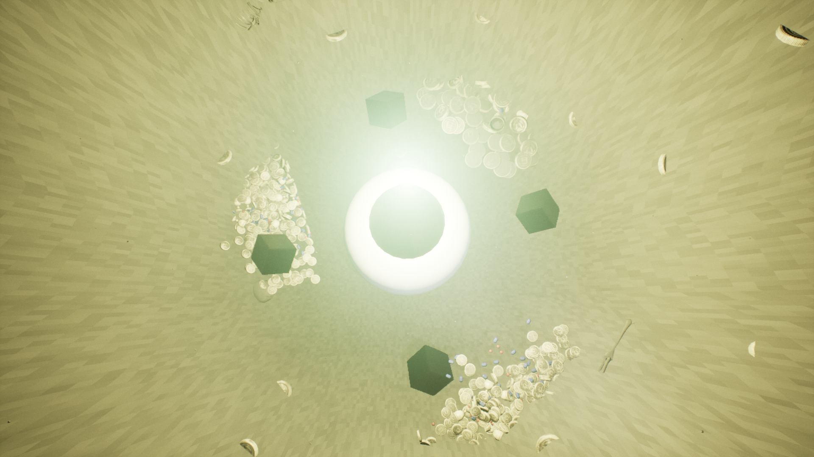
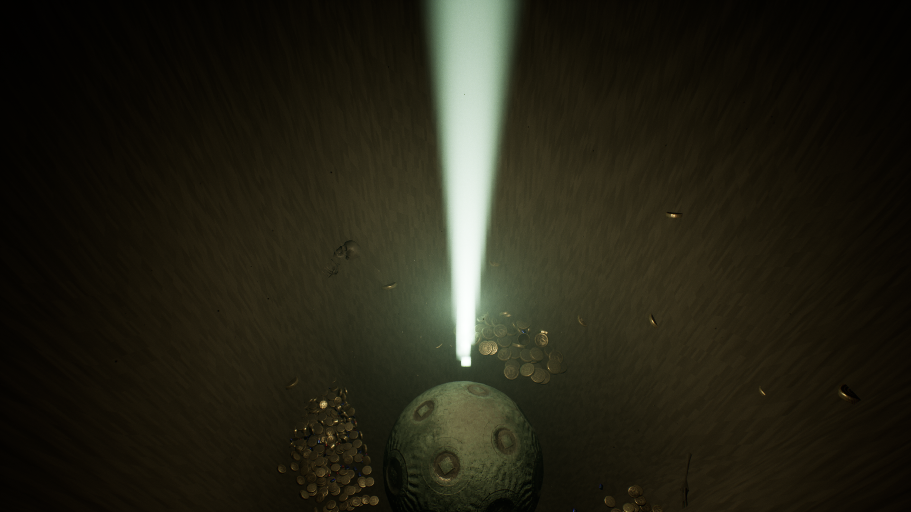
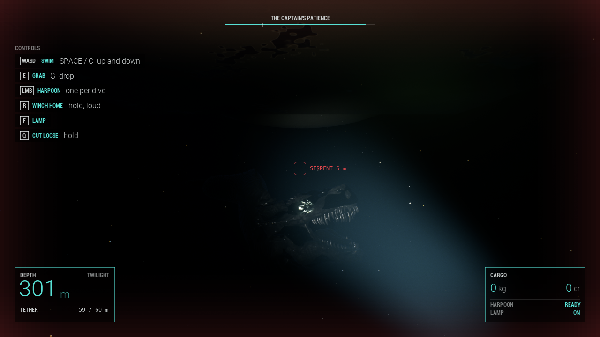
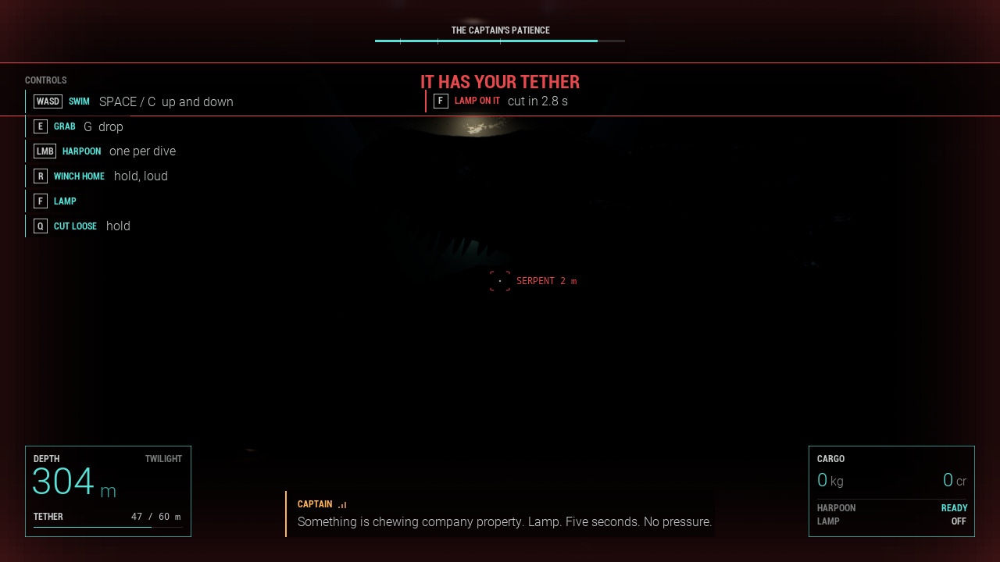
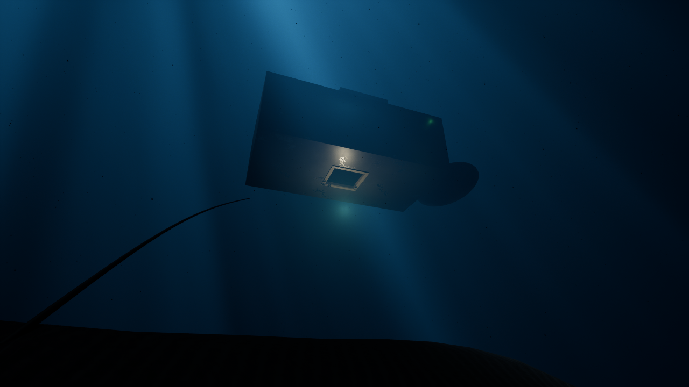
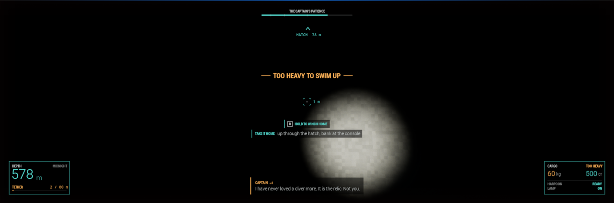

# DEEP dev log 3: Sunday morning, from 5:20 AM to 10 AM

This is the third post about DEEP, our entry for the 2026 Epic AI MegaJam. Quinn and Colby are making it with Claude agents in Unreal Engine 5.9. [Post two](02-sunday-before-dawn.md) ended at about 5:20 AM on Sunday Nov 15. By then Quinn had set the rules (no half-done polish, looks as important as gameplay, one style, a lean toward dark realism, agents allowed to make materials after looking things up), and the agents had built a first water look, the serpent, the room, the HUD, the helm view and the settings menu on separate branches. This post covers what happened next: a false alarm, a pack nobody knew was installed, a package that failed, and what it all cost. The build is due at 8:59 PM EST tonight.

One fact frames the rest. Quinn's last message came at about 3 AM. Everything below happened without him, and nothing has merged into `main`, because the rule is that he sees frames first.

## The alarm that was half wrong

At 5:22 AM a playtest agent ran the scripted player on the polish branch and reported that the game could not be won: the 60 kg relic overloads the diver, the winch is loud, the serpent cut the tether 4 to 5 seconds in. At 5:50 AM the orchestrator told Quinn the game could not be won.

That was wrong. An engineer first taught the scripted player to play the ending properly: hold the winch, aim the lamp at the serpent. With the old numbers it won 5 of 5. With the lamp off it still won 3 of 3. The failures came from the script, which pulsed the winch in 1.5 second bursts and let the serpent catch up. The real fault was the opposite one: a player who simply holds the winch is in no danger, because the winch was as fast as the serpent.

The fixes were small. The winch is 4 m/s with the relic (it was 7). The relic's shaft is straight under the hatch (it was 8 m out, and the winch line ran through the shaft wall). After the change 5 of 5 win with the lamp, and 0 of 3 win without it, all three dropping the relic and living. The playtest agent had noted that it did not know whether its script used the lamp. We did not stop to ask.

A scripted player is a witness, not a judge. Its failures need the same checking as an agent's claim of success.

## The pack that was already there

Fab has no build of the dragon pack for the 5.9 preview, so Quinn made a separate 5.7 project and brought the pack across. It landed on disk at 3:31 AM. He did not say so. For three and a half hours the task board said "waiting on Quinn to install Dragon Cave". At about 7:00 AM the orchestrator, checking the main checkout for something else, found 4.8 GB in 333 files. It reads only what agents report and what Quinn types, and neither covers what a human does on the disk. A look at `git status` each tick would have found the pack at once.

## The first build with the pack in it

At 8:10 AM the orchestrator cut a package without waiting for the planned checkpoint. It found three faults that 71 passing tests and two dozen good editor frames had not.

1. **1,318 MB against a 1 GB limit.** The 42 placed meshes were 7 MB. The 37 textures they reference were 1.9 GB of source.
2. **Grey rock.** The log said "missing usage flag Nanite! Default Material will be used in game". The editor sets that flag on the fly and a cooked game cannot. The frame still looked plausible, because the default material is grey, and so is silted rock under a lamp.
3. **A game that would not compile.** A debug line called a function that exists only in editor builds, and the merge gate builds only the editor.

The texture limit took three tries, each measured with a real package. `MaxLODSize=2048` gave 1,160 MB, because virtual textures ignore it. `MaxLODSize_VT=2048` gave 530 MB, but the pack's textures are grids of 4096 tiles, so every tile shrank to 256 pixels. `LODBias_VT=1` drops one mip from every virtual texture whatever its grid: 679 MB. The answers came from reading `TextureLODSettings.cpp` in the installed engine and from a 60-line script that reads each texture's size from its file header, not from memory of how the engine behaves. With the dragon's head in, the zip is 762 MB. A branch with C++, materials or pack content is now packaged when it merges.

## Frames that failed and went back

The orchestrator writes a verdict on every frame. Two lanes went back with a written review.

*8:04 AM. The bottom of the relic's shaft, where every winning player ends up. The orchestrator called it "a debug view": a relic light of 12,000 units burned the pit out.*

*8:53 AM, lamp off. The light is 1,200 units over 7 m, and a narrow beam rises up the shaft as a beacon visible from the hatch.*

**The black pillars.** Upright stone at 500 m stayed black in the beam. The tempting fix was more light. The engineer turned lighting off with one console command instead. The pillar's base colour was still black while rock beside it was textured, so light was not the cause. The surface had picked up the pack's default textures, and chose the wrong texture type until a texture had been built. Asking why it was dark before adding a light saved a wrong fix.

**The dragon's head.** The pack is a whole winged dragon about 250 m across, with no head to take. The head is cut out of it in a material and set in the serpent's head socket. At 6 m in the lamp it is teeth and one eye shining back, where the old head looked like a small fish.

*The head works.*

**The bite, which still does not read.** The jaw cannot move, so the bite is staged with the head side-on and the line across its open mouth. With the lamp off it is nearly black. With the lamp on the teeth smear.

*9:10 AM. The teeth are there if you look for them. A player will not look for them.*

**The tether.** It was a stretched cylinder until the rope merged at 9:52 AM, after the gate finished at 9:51 with 76 of 76 tests and a 762 MB zip. The engineer read the engine's own cable component and rejected it: it is not enabled in the project, and it rebuilds world-space vertices each frame, the same smear trap the dragon lane had hit that morning. It built its own rope instead: a small simulation of 36 points, drawn as 35 short cylinders that each write their own motion.

*One second after the Captain cuts the line. The submarine above it is still a box in this frame.*

The engineer was also asked for bubbles and declined to half-build them. It wrote the recipe down and stopped.

## What staged frames hide

The scripted playthrough at 9:06 AM passed: down the shaft by keys, relic taken, winched home in 21 seconds, a win. Its own screenshot at the relic tells another story.

*9:06 AM, from the scripted playthrough, lamp on, about 1 m from the pit floor beside the relic. The pool is a flat white disc with visible blocks.*

The staged well frames missed this because they were framed from 2 m at an angle. Then the dragon engineer found that the white burn in its recoil frame was never the head. It was the 16 m body, coiled in the lamp at 2 m: the same fault as the white floor. The test passed and the picture failed, and the picture is what a player sees. Both went to one new lane on the lamp, started at 9:18 AM (run 68).

## What it cost

The figures below are the run ledger's rows, not a bill. The ledger logs these Opus 5.5 engineer runs at high effort from 5:22 AM on: the ending fix at 274k tokens in 55 minutes, the dragon's first pass at 460k in 88, the first dressing pass at 492k in 66, and the rope at 305k in 47. Adding the ledger's nine rows for runs 58 to 66, which include a playtest run, a writer and the resumed passes, gives about 3.2 million tokens. That sum is ours, not the ledger's.

A resumed agent carries its whole history. The second pass on the well cost 691k tokens in 42 minutes; the first pass cost 492k in 66. We now resume for a review of the same work and start fresh for new work.

The orchestrator writes no game code. It dispatches, looks at every frame, merges, and runs the gate and the package itself. That did not make it reliable: its earlier red merge, in post two, came from a gate wrapper that threw the exit code away.

## Not done at 10 AM

- **Nobody has played the game by hand.** A script is not a player.
- **No gameplay video.** That needs a person at the keyboard.
- **No voice for the Captain.** All sound is generated in code, and as of the log nobody has listened to it.
- **The submarine's hull is minutes old.** An engineer built one from basic shapes and handed it back at 9:56 AM. It is being merged as this is written, and no person has seen it.
- **The bite is too dark to read**, and the lamp still burns close surfaces white.
- **The pack's licence.** The listing says "personal". Quinn has to check that it covers a public jam entry.

The tests are green at 76 of 76 and the zip is 762 MB of the 1,024 allowed. None of that tells us whether the game is good to play.

